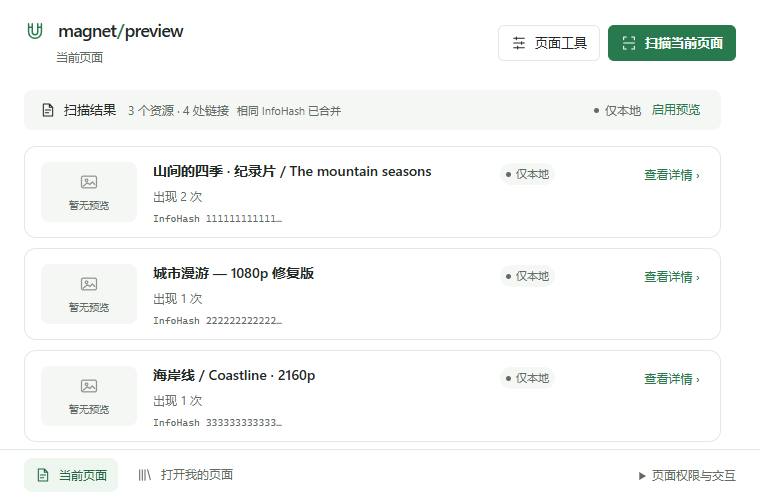
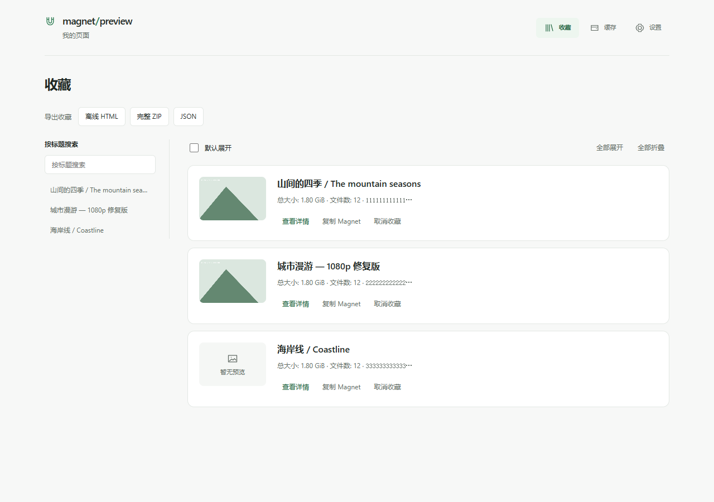
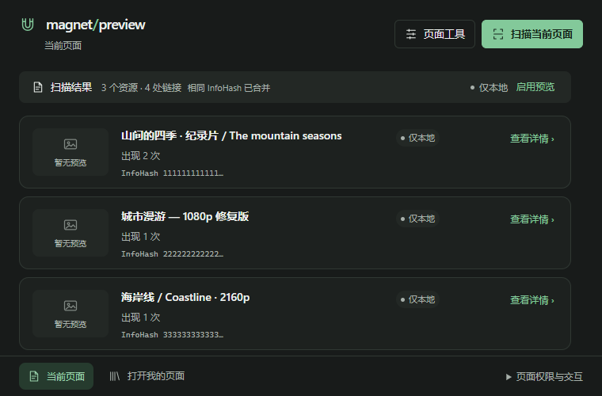

# Magnet Preview

**先了解，再决定。** 一个注重隐私与操作控制的浏览器扩展，帮助你整理网页中的磁力链接、查看可用的资源信息，并收藏值得保留的内容。

[English](README_EN.md) · [功能与截图](#功能) · [安装](#安装) · [隐私与权限](#隐私与权限) · [参与开发](#开发)

> 项目仍在开发中，目前通过源码构建安装；尚未完成最终的真实 Chrome 发布验收。预览结果取决于第三方服务与资源可用性。

## 为什么需要它？

面对一个包含多个磁力链接的网页，你可能只想先看看资源信息，确认是否值得保存。Magnet Preview 把**当前页扫描、去重、预览和收藏**放在同一个轻量工作流中，让你不必在多个页面之间反复整理链接。

它适合整理你有权访问的电影、纪录片、公开资料和其他资源。扩展本身**不下载文件、不播放视频，也不内置 BitTorrent 客户端**。

## 功能

- **扫描当前网页**：主动扫描页面中的 Magnet 链接，相同 InfoHash 自动合并，快速了解资源数量。
- **按需获取预览**：用户同意后，可通过 WhatsLink 查询可用的资源信息和图片；没有预览时也能继续使用本地扫描结果。
- **页面内快捷操作**：可选择在链接附近显示信息，或在当前页启用悬停预览；悬停预览默认关闭。
- **收藏与离线导出**：保存感兴趣的资源，支持 HTML、ZIP 和 JSON 导出。收藏与可清理的预览缓存分开管理。
- **自己的使用方式**：支持中文和英文、浅色和深色主题，以及可配置的页面工具。

### 当前页扫描



### 资源详情与图片预览


### 收藏与深色主题

| 收藏 | 深色主题 |
| --- | --- |
|  |  |

以上截图使用合成的演示标题、InfoHash 和图片，并非真实资源。

## 安装

当前需要从源码构建。请先安装 [Node.js](https://nodejs.org/) 22 或更新版本，以及 npm 和支持 Manifest V3 的 Chromium 浏览器。

```bash
git clone https://github.com/Xie-Fantasy/magnet-preview.git
cd magnet-preview
npm ci
npm run build
```

1. 在 Chrome 中打开 `chrome://extensions`，启用右上角的「开发者模式」。
2. 点击「加载已解压的扩展程序」，选择项目中的 `.output/chrome-mv3` 文件夹。
3. 打开包含 Magnet 链接的网页，点击扩展图标，选择「扫描当前页面」。
4. 按界面提示决定是否启用在线预览；页面内悬停和自动显示页面工具均需单独设置。

更新源码后重新执行 `npm ci`（依赖变化时）和 `npm run build`，然后在扩展管理页面点击重新加载。首次使用和权限提示的具体外观可能随浏览器版本变化。

## 隐私与权限

扫描在本地完成。在线预览由用户选择启用：请求预览时，相关 Magnet/InfoHash 会从浏览器发送给第三方服务 [WhatsLink](https://whatslink.info/)，预览图片也可能由第三方提供。项目不运营接收这些请求的自有后端。请勿对不希望发送给该服务的链接启用在线预览，并自行了解第三方服务的数据处理方式。

| 权限 | 用途 |
| --- | --- |
| `activeTab`、`scripting` | 在用户主动操作时访问当前标签页并运行扫描或页面工具。 |
| `storage` | 保存设置与本地状态。 |
| `alarms` | 安排预览缓存清理。 |
| `https://whatslink.info/*` | 连接预览服务；服务请求由用户的预览操作触发。 |
| 可选的网站访问权限 | 仅在用户为指定网站开启自动显示页面工具时申请；不是默认授权全部网站。 |

预览缓存可以清理；收藏以独立的持久记录保存。卸载扩展或清除扩展数据可能删除本地记录，请使用导出功能保存需要保留的数据。

## 开发

```bash
npm ci
npm run dev          # 开发构建
npm run check        # 类型检查、lint、单元测试与生产构建
npm run test:e2e     # 构建并运行 Playwright 浏览器测试
```

浏览器测试需要安装 Playwright 的 Chromium：`npx playwright install chromium`。项目使用 TypeScript、React、WXT 和 Manifest V3；页面交互、预览请求和本地存储分别位于 `src/content`、`src/application`、`src/entrypoints` 等目录。在线请求由后台服务经统一的预览管理器和服务适配器处理。

欢迎提交问题和改进建议。报告问题时，请说明复现步骤、浏览器版本与预期行为；请先移除真实磁力链接、个人信息和其他敏感数据。请尊重资源权利人的合法权益，并遵守所在地区适用的法律。

## 许可证

[MIT](LICENSE)
