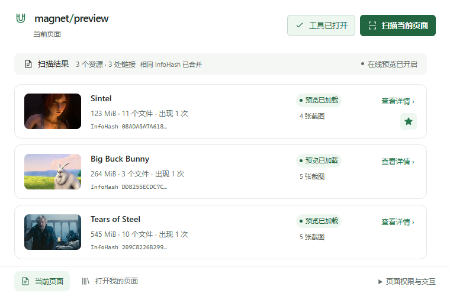
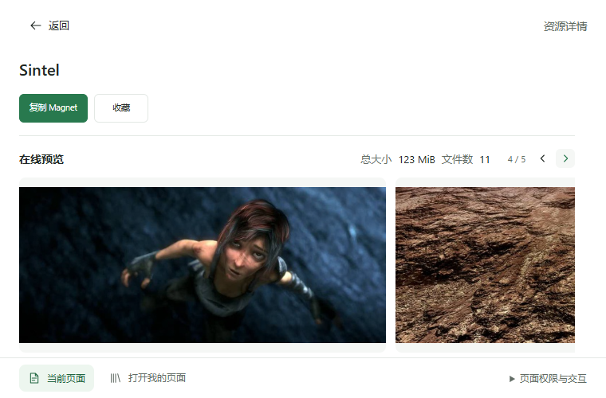
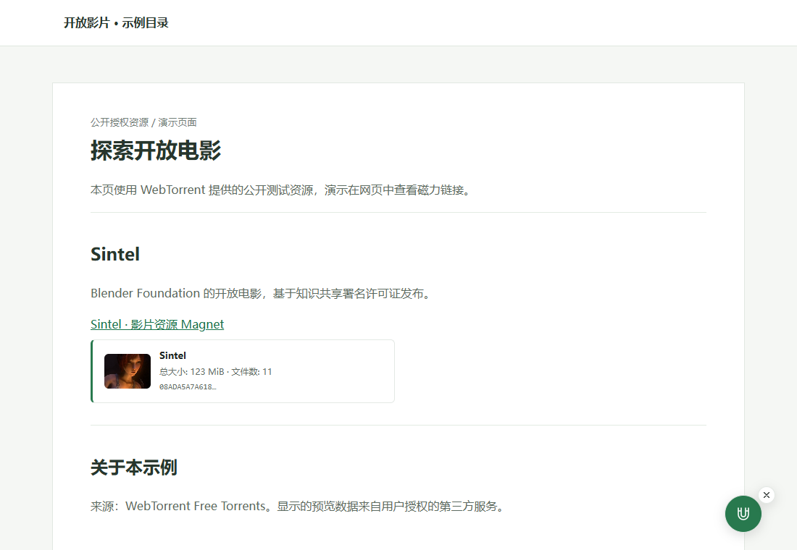
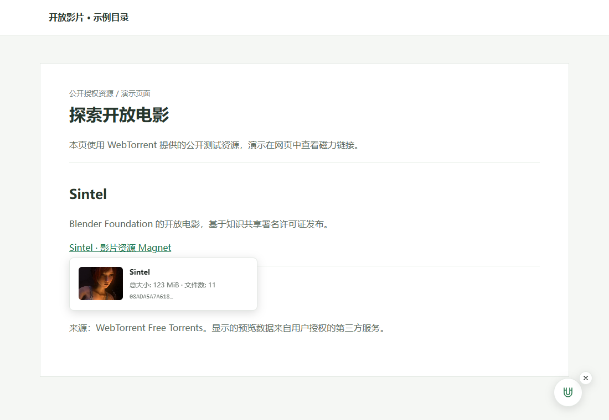
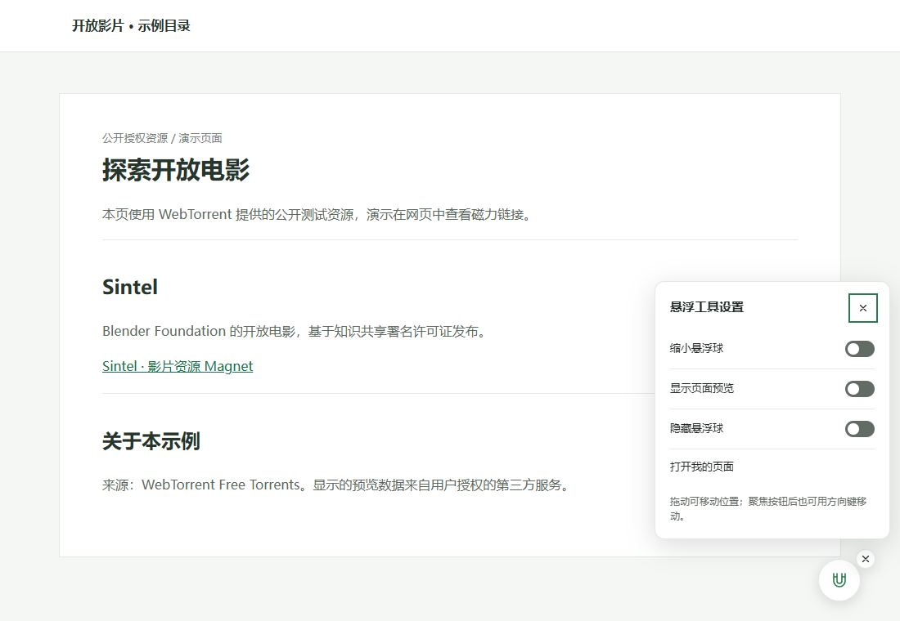
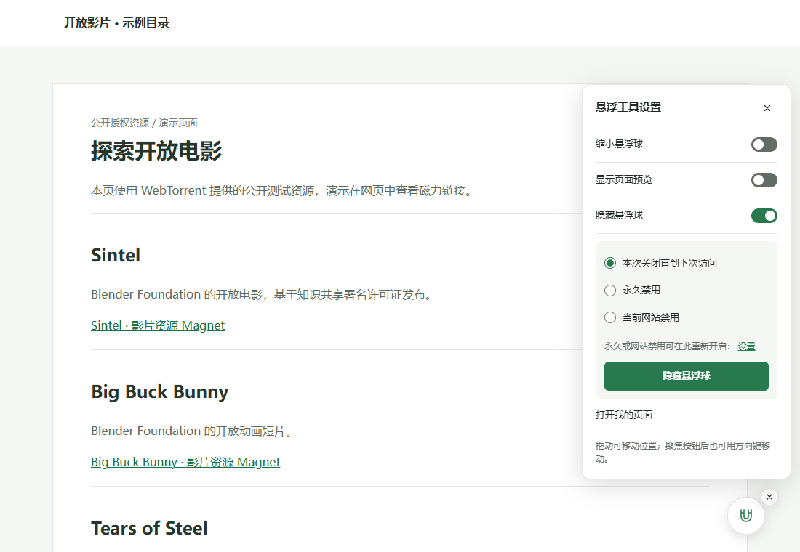
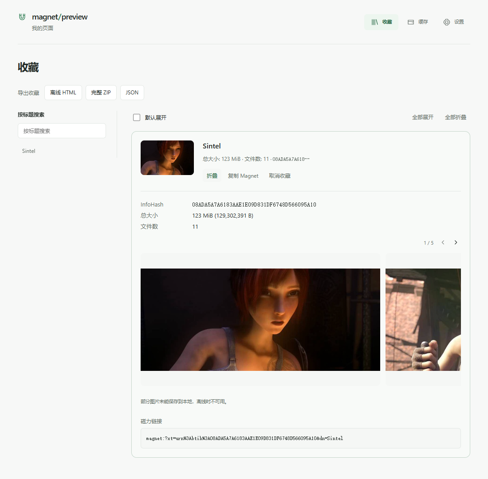
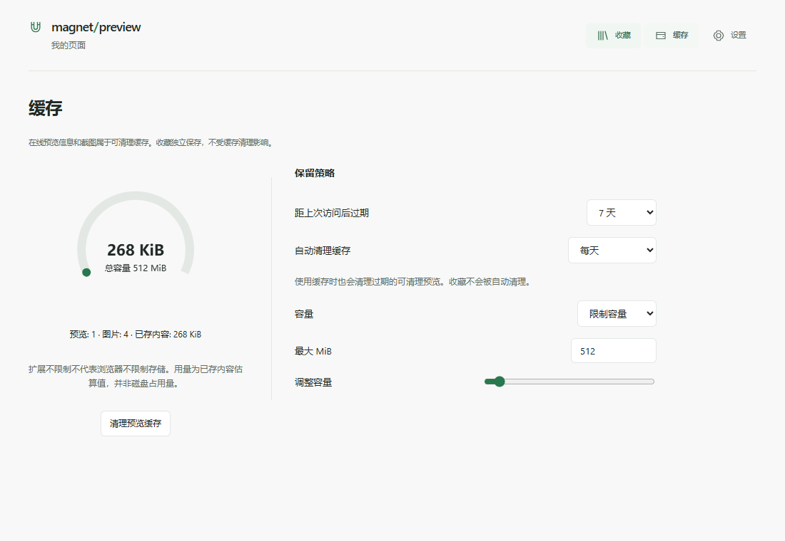
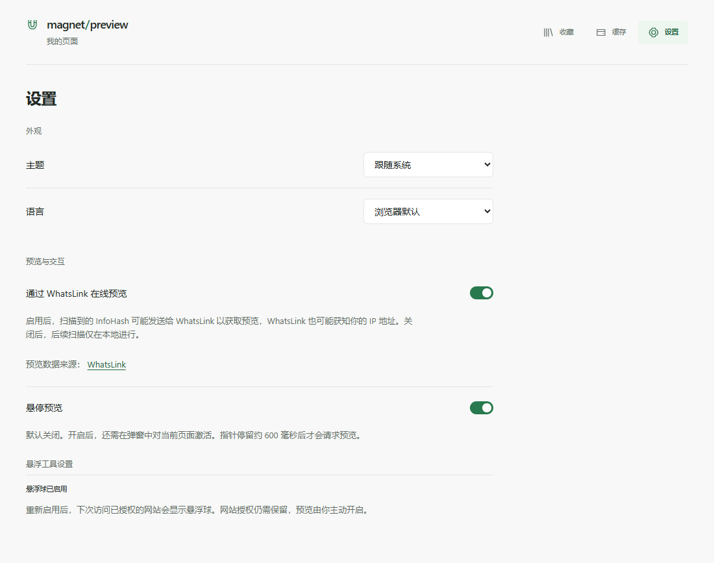
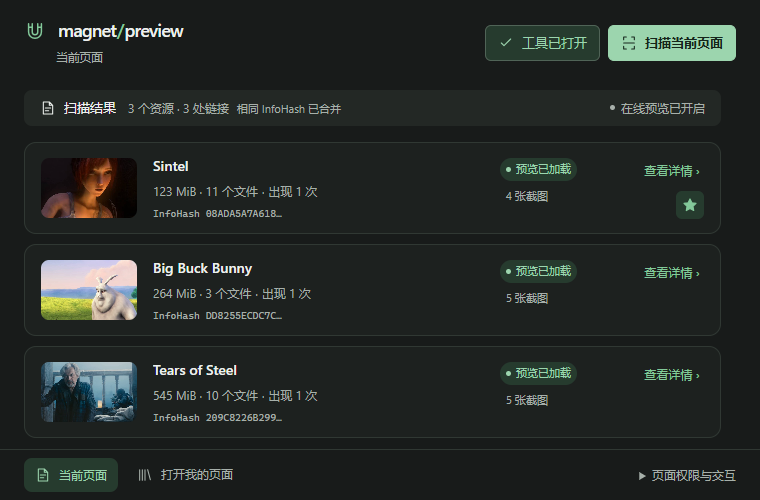

# Magnet Preview

**Know more before you open a Magnet link.** A local-first browser extension for finding, organizing and previewing Magnet links on the current page.

[简体中文](README.md) · [Screenshots](#screenshots) · [Install](#install) · [Privacy and permissions](#privacy-and-permissions) · [Development](#development)

> This project is under active development and is installed from source. Final acceptance in an installed Chrome browser is still pending. Online results depend on the third-party provider and resource availability.

## What it does

- Scan the current page locally and merge links with the same InfoHash.
- Request resource information and images from WhatsLink after you opt in.
- Show optional inline previews and enable hover previews for the current page. Hover is off by default.
- Keep favorites separately from disposable preview cache and export them as HTML, ZIP or JSON.
- Choose Chinese or English and a light or dark theme; configure the floating page tool.

Use it to organize films, documentaries, public materials and other resources you are entitled to access. Magnet Preview is not a downloader, video player or BitTorrent client.

## Screenshots

These are captures of the running extension using real, publicly licensed Magnet links. The page hosting the links is a purpose-built local demo; resource metadata and images came from WhatsLink after consent, not a simulated provider.

### Scan and online details





### On-page previews and floating controls

| Inline preview | Hover preview |
| --- | --- |
|  |  |

| Floating tool | Hide options |
| --- | --- |
|  |  |

### Favorites, offline export and preferences

| Favorites | Exported offline HTML |
| --- | --- |
|  |  |

| Cache management | Settings |
| --- | --- |
|  |  |

### Dark theme



During capture, some images returned errors from the third-party provider, so the favorite and offline export may report partially unavailable images. Availability can change.

Magnet links are from [WebTorrent's free-torrent list](https://webtorrent.io/free-torrents). Movie frames are owned by their authors and licensed under [CC BY 3.0](https://creativecommons.org/licenses/by/3.0/); frames are scaled and partially shown within the extension screenshots:

- *Sintel* — © Blender Foundation | [sintel.org](https://durian.blender.org/sharing/).
- *Big Buck Bunny* — © 2008 Blender Foundation / [bigbuckbunny.org](https://peach.blender.org/about/).
- *Tears of Steel* — © Blender Foundation / Blender Institute | [mango.blender.org](https://mango.blender.org/about/).

## Install

Install [Node.js](https://nodejs.org/) 22 LTS (22.12 or later within 22.x) or 24 LTS, and npm, then run:

```bash
git clone https://github.com/Xie-Fantasy/magnet-preview.git
cd magnet-preview
npm ci
npm run build
```

In Chrome, open `chrome://extensions`, enable Developer mode, select **Load unpacked**, and choose `.output/chrome-mv3`. Open a page containing Magnet links, click the extension and scan the current page. Follow the interface to opt in to online previews or enable optional page tools. Rebuild and reload the extension after updates.

## Privacy and permissions

Scanning is local. When you choose to request an online preview, the related Magnet/InfoHash is sent from your browser to [WhatsLink](https://whatslink.info/); preview images may also be provided by third parties. This project operates no backend to receive those requests. Review the provider's own data practices before sharing links with it.

| Permission | Purpose |
| --- | --- |
| `activeTab`, `scripting` | Scan or run page tools on the current tab following a user action. |
| `storage` | Store preferences and local state. |
| `alarms` | Schedule preview-cache cleanup. |
| `https://whatslink.info/*` | Access the preview provider when a preview is requested. |
| Optional website access | Requested for a specific site when you enable its automatic floating tool; not granted to all sites by default. |

Favorites are stored separately from disposable preview cache. Removing the extension or clearing its data may delete local records; export anything you need to keep.

## Development

```bash
npm ci
npm run dev
npm run check
npm run test:e2e
```

Install the Playwright browser with `npx playwright install chromium`. Built with TypeScript, React, WXT and Manifest V3. Requests go through the background preview manager and provider adapter. Please remove real Magnet links and personal information from reports, respect rights holders and follow applicable laws.

## License

Project code is licensed under [MIT](LICENSE). The open-movie frames in the README are covered by the attribution and license above.
